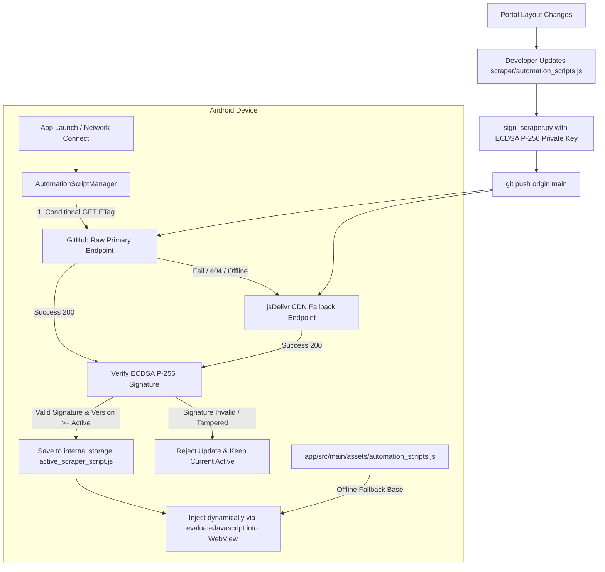

# JNTUA Attendance — Over-The-Air (OTA) Scraper Update Guide

This document describes the design, security architecture, runtime lifecycle, and step-by-step developer procedure for deploying Over-The-Air (OTA) automation script updates to the JNTUA Attendance Android app.

---

## 1. Why OTA Scraper Updates?

The JNTUA Student Attendance portal (`https://jntuaceastudents.classattendance.in`) is an external web application whose HTML structure, forms, table selectors, and session tokens can change without notice.

- **Without OTA**: Any portal markup change breaks the app. The developer must edit Kotlin/JS code, bump the APK version code, compile a release APK, sign it with a keystore, distribute it to users, and wait for students to download and install the new APK.
- **With OTA**: The scraper automation engine (`automation_scripts.js`) is completely decoupled from the Android APK binary. When the portal structure changes, the developer updates the JavaScript file, signs it with an ECDSA private key, and pushes it to GitHub. The app silently downloads, verifies, and installs the update within seconds—no APK rebuild or user action required.

---

## 2. System Architecture



### Endpoints

| Priority | Endpoint | URL | Purpose |
|---|---|---|---|
| **Primary** | GitHub Raw | `https://raw.githubusercontent.com/Chanikya-WebDev/JNTUA-Mobile-Attendance-App/main/scraper/automation_scripts.js` | Direct, instantaneous updates upon `git push` |
| **Fallback** | jsDelivr CDN | `https://cdn.jsdelivr.net/gh/Chanikya-WebDev/JNTUA-Mobile-Attendance-App@main/scraper/automation_scripts.js` | High-availability global edge cache if GitHub raw is rate-limited or blocked |
| **Built-in** | Bundled Asset | `app/src/main/assets/automation_scripts.js` | Embedded inside APK; guaranteed offline baseline |

---

## 3. Cryptographic Security (Zero-Trust Model)

Allowing dynamic code execution inside an Android `WebView` requires rigorous security controls to prevent Man-in-the-Middle (MITM) attacks, malicious CDN cache poisoning, or unauthorized script injection.

### Security Guarantees
1. **Asymmetric Cryptography (ECDSA P-256)**:
   - **Private Key (`scripts/scraper_private_key.pem`)**: Stored exclusively on developer workstations. Never packaged into the APK or committed to public branches.
   - **Public Key (`PUBLIC_KEY_PEM`)**: Hardcoded inside `AutomationScriptManager.kt`.
   - **Algorithm**: `SHA256withECDSA` on the NIST P-256 (`secp256r1`) elliptic curve.
2. **Canonical Hashing**:
   - The signature is placed on line 6: `// Signature: <base64-der-ecdsa>`.
   - When verifying, the app strips the `// Signature:` line and normalizes all line endings (`\r\n` to `\n`) before computing the SHA-256 digest.
   - Any modification, injection, truncation, or tampering instantly invalidates the signature.
3. **Structural Validation**:
   - Even if signed, scripts must contain critical scraper symbols (`window.JNTUAScraper`, `handlePageLoad`, `selectSubjectByIndex`).
4. **Bundled Asset Upgrade Trap Protection**:
   - When a user installs a newer APK from the Play Store/GitHub with updated bundled assets, the app detects that `currentAppVersionCode > savedInstalledAppVersion` and automatically clears stale cached OTA scripts, ensuring new APK assets take precedence.

---

## 4. Network Polling & Caching Strategy

To minimize mobile battery drain and cellular data usage:
- **HTTP Conditional GET (`ETag` / `If-None-Match`)**: The app sends the cached ETag header. If the script on GitHub has not changed, the server returns `HTTP 304 Not Modified` with 0 bytes body.
- **15-Minute Cooldown**: Background silent checks are throttled to a minimum of 15 minutes between network requests (`COOLDOWN_MS = 15 * 60 * 1000L`).
- **Reactive Wakeup**: When the device transitions from offline to online via `NetworkMonitor`, a silent update check is triggered automatically.
- **Manual Trigger**: Users or developers can tap "Check for Updates" in the app menu to bypass the 15-minute cooldown (`force = true`).

---

## 5. Step-by-Step Developer Procedure

Follow this checklist whenever updating the scraper automation script.

### Step 1: Make Scraper Modifications
Edit `scraper/automation_scripts.js` (and keep `app/src/main/assets/automation_scripts.js` in sync):
- Address any changes in the portal HTML (e.g., changes to form actions, input field names, or subject table row selectors).
- Always maintain backwards compatibility with existing bridge message types (`STUDENT_INFO`, `SUBJECT_COUNT`, `ATTENDANCE_ITEM`, `SUBJECT_SKIPPED`, `SCRAPING_COMPLETE`, `SCRAPE_ERROR`).

### Step 2: Increment Scraper Version
Open `scraper/automation_scripts.js` and update the version string:
```javascript
window.JNTUAScraper = {
    version: "2026.10.19.1", // Format: YYYY.MM.DD.patch
    portalBaseUrl: "https://jntuaceastudents.classattendance.in",
...
```

### Step 3: Digitally Sign the Script
Run the signing utility from the repository root:
```bash
python3 scripts/sign_scraper.py
```

Expected output:
```text
✓ Signed: .../app/src/main/assets/automation_scripts.js
  Signature: MEQCIG...
✓ Signed: .../scraper/automation_scripts.js
  Signature: MEUCIQ...
Successfully signed 2 file(s).
```

> **Note**: `sign_scraper.py` reads `scripts/scraper_private_key.pem`, computes the ECDSA SHA-256 signature, and embeds `// Signature: <base64>` into the script headers.

### Step 4: Run Cryptographic & Unit Tests
Verify that the generated signature passes validation against the embedded public key:
```bash
./gradlew test
```

The test `bundledAssetScript_hasValidSignatureAndPassesValidation` in `AutomationScriptManagerTest.kt` verifies:
- Extraction of the signature line.
- Full ECDSA signature verification against `AutomationScriptManager.PUBLIC_KEY_PEM`.
- Version comparison semantics (`compareVersions`).
- Canonical hash calculation and tamper rejection.

### Step 5: Test Locally (Optional)
Run the app on a connected Android device or emulator to test against the live portal:
```bash
./gradlew assembleDebug
# or install directly
./gradlew installDebug
```

### Step 6: Commit and Push to GitHub
Commit the signed scripts and push to the `main` branch:
```bash
git add scraper/automation_scripts.js app/src/main/assets/automation_scripts.js
git commit -m "feat(scraper): update scraper automation script to v2026.10.19.1"
git push origin main
```

### Step 7: Verify Live Deployment
1. Open the primary GitHub Raw URL in your browser:
   `https://raw.githubusercontent.com/Chanikya-WebDev/JNTUA-Mobile-Attendance-App/main/scraper/automation_scripts.js`
   Verify that HTTP 200 is returned and the new version string and signature are visible.
2. In the Android app, navigate to settings/options and tap **Check for Updates** or restart the app. The app logs:
   ```text
   [I/AutomationScriptManager] Script updated: v2026.10.18.1 -> v2026.10.19.1 (SHA: ...)
   [I/AttendanceViewModel] Script updated to v2026.10.19.1. Reloading portal...
   ```

---

## 6. Key Management & Rotation

### Key Location
- Private Key: `scripts/scraper_private_key.pem` (Keep secure! Never commit to public branches or publish in APKs).
- Public Key: `scripts/scraper_public_key.pem` and embedded in `app/src/main/java/com/chanikya501/jntuaattendance/webview/AutomationScriptManager.kt`:
  ```kotlin
  private const val PUBLIC_KEY_PEM = """
  -----BEGIN PUBLIC KEY-----
  MFkwEwYHKoZIzj0CAQYIKoZIzj0DAQcDQgAEPfP9dJ2bY59oH+fP3L44PqmB4Gq9...
  -----END PUBLIC KEY-----
  """
  ```

### Key Rotation Procedure
If the private key is compromised or needs rotation:
1. Generate a new ECDSA P-256 key pair:
   ```bash
   openssl ecparam -name prime256v1 -genkey -noout -out scripts/scraper_private_key.pem
   openssl ec -in scripts/scraper_private_key.pem -pubout -out scripts/scraper_public_key.pem
   ```
2. Copy the contents of `scripts/scraper_public_key.pem` into `PUBLIC_KEY_PEM` inside `AutomationScriptManager.kt`.
3. Sign scripts using `python3 scripts/sign_scraper.py`.
4. Deploy an APK update with the new public key.

---

## 7. Troubleshooting & Diagnostic Logs

| Diagnostic Log Entry | Root Cause | Solution |
|---|---|---|
| `Primary URL check failed (HTTP 404)` | GitHub branch or file path is incorrect or file not pushed. | Verify `scraper/automation_scripts.js` is pushed to `main`. |
| `Script signature verification failed!` | Script was modified after signing or line endings were converted improperly. | Re-run `python3 scripts/sign_scraper.py` and `./gradlew test`. |
| `304 Not Modified` | Script has not changed since last check (ETag matched). | Normal behavior; saves bandwidth. |
| `Silent update check skipped: cooldown active` | Check occurred within 15 minutes of previous check. | Normal behavior. Use manual check to bypass cooldown. |
| `Stale cached script purged` | App was upgraded to a new APK version with a newer bundled script. | Expected; ensures bundled assets supersede older OTA scripts. |

---

## 8. Summary Checklist for Every Scraper Update

- [ ] Updated JS logic in `scraper/automation_scripts.js`
- [ ] Copied JS to `app/src/main/assets/automation_scripts.js`
- [ ] Bumped `version` string in `window.JNTUAScraper`
- [ ] Ran `python3 scripts/sign_scraper.py`
- [ ] Ran `./gradlew test` (All tests pass)
- [ ] Committed and pushed to `main`
- [ ] Confirmed HTTP 200 on `https://raw.githubusercontent.com/.../scraper/automation_scripts.js`
